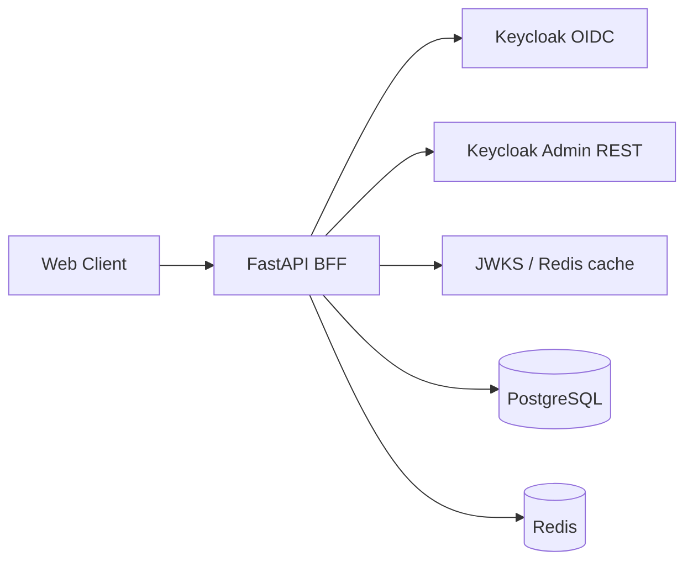
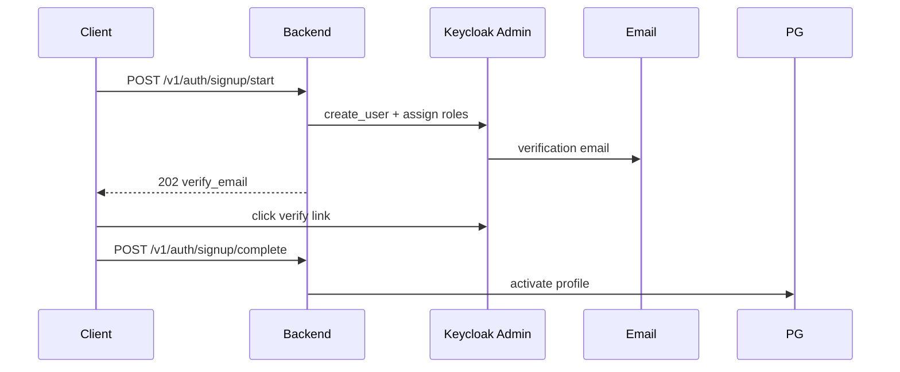
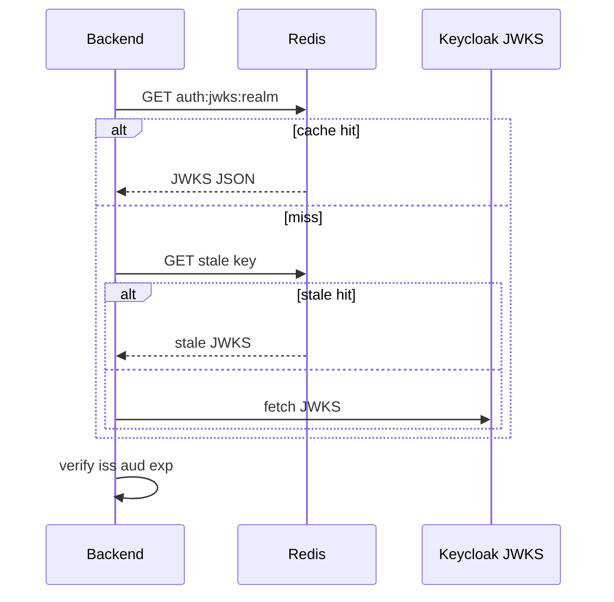
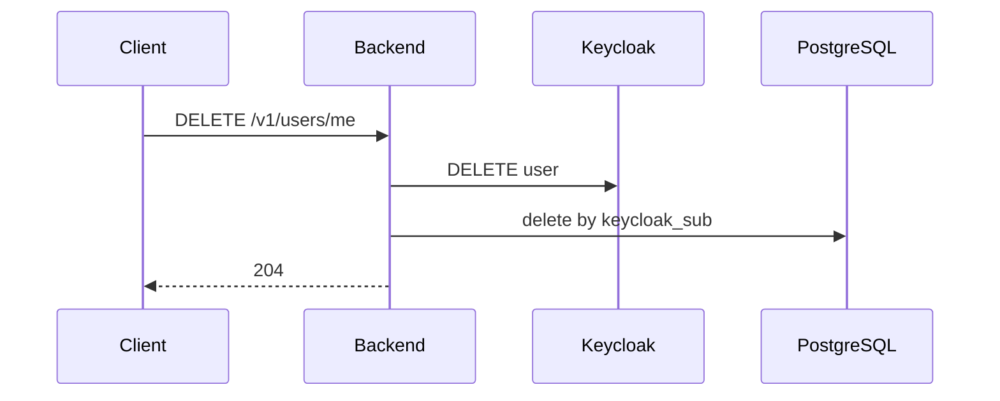
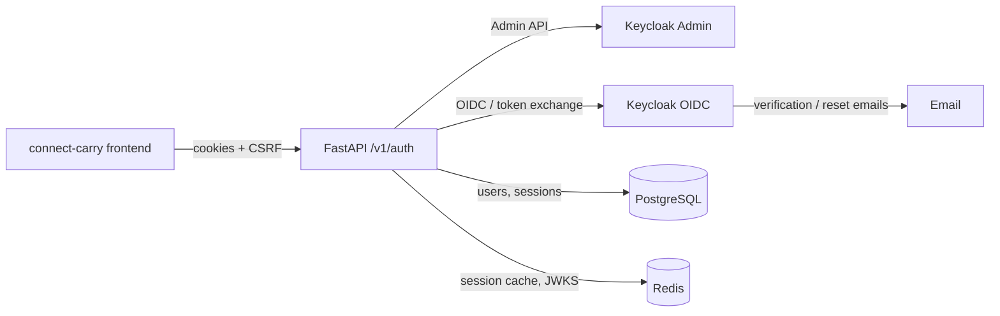
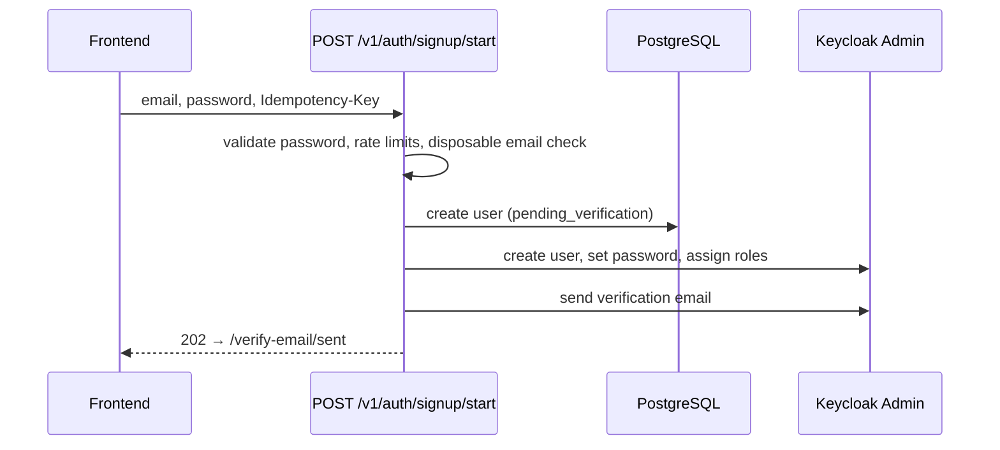
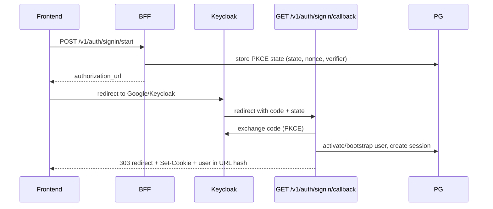

# Auth Architecture

## Components



## Signup sequence



## JWT validation



## Account deletion



## Code map

| Concern | Module |
|---------|--------|
| OIDC (auth code, refresh) | `domains/auth/keycloak_client.py` |
| Admin REST | `infrastructure/keycloak/admin_client.py` |
| JWT verify | `infrastructure/keycloak/adapter.py` |
| Startup checks | `infrastructure/keycloak/startup_validation.py` |
| Config | `config.yaml`, `core/config/settings.py` |


# Auth end-to-end

This stack uses a **Backend-for-Frontend (BFF)** pattern: the browser never holds Keycloak tokens directly. Keycloak handles identity (OIDC); your FastAPI backend owns **app sessions**, **Postgres user state**, and **cookies**.



---

## Core idea

| Layer | Responsibility |
|--------|----------------|
| **Keycloak** | Password storage, email verification, OAuth (Google), JWT issuance |
| **PostgreSQL** | App user record, lifecycle status, BFF sessions, signin PKCE state |
| **FastAPI BFF** | Orchestrates signup/signin, sets HttpOnly session cookies, validates requests |
| **Frontend** | Calls BFF APIs, stores no tokens; reads user from callback hash or `/v1/auth/session` |

Protected API routes accept either:
1. **`Authorization: Bearer <JWT>`** (direct Keycloak token), or  
2. **Session cookie** (`pp_session`) resolved server-side into a principal.

That logic lives in `v1/middleware/authentication.py`.

---

## User lifecycle (Postgres)

Users move through statuses defined in migrations:

| Status | Meaning |
|--------|---------|
| `pending_verification` | Signed up; email not verified / not activated locally |
| `pending_profile_setup` | Verified; needs display name + role (explorer vs connector) |
| `active` | Fully onboarded |
| `restricted` | Signup provisioning failed |

**Important rule:** Clicking Keycloak’s verify-email link updates **Keycloak only**. Postgres stays `pending_verification` until the user **signs in** (or the background reconcile job runs).

---

## Flow 1 — Email/password signup



**Steps in code:**

1. Frontend (`SignupPage`) calls `POST /v1/auth/signup/start` with `Idempotency-Key`.
2. `AuthService.signup_start()` validates input, applies abuse controls (IP/device/domain limits, optional captcha).
3. `SignupStartProvisioner`:
   - Creates a pending Postgres user
   - Creates Keycloak user via Admin API
   - Sets password in Keycloak (not stored in Postgres)
   - Sends verification email via Keycloak
4. User lands on **verify email sent** page.

Duplicate/disposable emails get a **generic success response** (no account enumeration).

---

## Flow 2 — Email verification

1. User clicks link in email → Keycloak marks `emailVerified=true`.
2. User is **not logged in yet** and Postgres is still `pending_verification`.
3. User goes to **login** (password or OAuth).

On successful sign-in, `_activate_or_reject_signin()` in `domains/auth/service.py`:

- Requires `principal.email_verified == true`
- Calls `activate_after_verified_signin()` → status becomes `pending_profile_setup` or `active` depending on whether profile/onboarding was completed

If they try to sign in before verifying, they get `email_verification_required`.

**Safety net:** `verification_reconcile` background job polls Keycloak for verified-but-not-activated users.

---

## Flow 3 — Sign in (OAuth / Google)



1. **`POST /v1/auth/signin/start`** — creates one-time PKCE state in Postgres, returns Keycloak authorization URL.
2. Browser completes OAuth at Keycloak.
3. Keycloak redirects to **`GET /v1/auth/signin/callback?code=...&state=...`** (backend URL, not frontend).
4. Backend exchanges code, verifies JWT, activates/links user, creates BFF session.
5. Redirects to frontend callback (e.g. `http://localhost:5173/home/auth/callback`) with:
   - **HttpOnly cookies:** `pp_session`, `pp_csrf`
   - **URL hash:** `#u=<base64 user json>` for immediate client state

Frontend `AuthCallbackPage` parses the hash, dispatches login, then routes via `resolvePostAuthPath()`.

---

## Flow 4 — Sign in (email/password)

**`POST /v1/auth/signin/password`** — server-side Keycloak **resource-owner password grant** (dev-oriented; direct access grants must be enabled on `chatapp-web` in Keycloak).

Same outcome as OAuth callback: session cookies set, user returned in JSON (no redirect).

---

## Flow 5 — Onboarding / role selection

After sign-in, frontend checks user status:

```typescript
// connect-carry/src/app/auth/lib/post-auth-routing.ts
pending_verification → /verify-email/sent
needs onboarding     → /onboarding
active + account_mode → /explorer or /connector
```

**`POST /v1/auth/onboarding/complete`** (authenticated) sets display name + `account_mode` (`explorer` | `connector`), updates Keycloak profile, moves user to `active`.

There is also **`POST /v1/auth/signup/complete`** for completing profile during signup with a `signup_token` (step 2 of signup flow if used).

---

## Flow 6 — Session model

When sign-in succeeds, the BFF:

1. Generates opaque `session_token` + `csrf_token`
2. Stores encrypted Keycloak access/refresh/id tokens in Postgres
3. Sets cookies on the response

On each protected request with the session cookie:

1. `AuthSessionResolver` loads session by hash
2. Refreshes Keycloak tokens if near expiry
3. Verifies JWT via JWKS (cached in Redis)
4. Attaches `KeycloakPrincipal` + `AuthSession` to `request.state`

Session APIs:
- `GET /v1/auth/session` — current user (also bootstraps user if needed)
- `GET /v1/auth/sessions` — list sessions
- `DELETE /v1/auth/sessions/{id}` / `/sessions/all` — revoke

**Logout:** `POST /v1/auth/logout` revokes local session, clears cookies, returns Keycloak logout URL.

---

## Flow 7 — Forgot password

**`POST /v1/auth/forgot-password`** → Keycloak sends reset email. Response is always generic (no email enumeration).

---

## Flow 8 — Social signup

**`POST /v1/auth/signup/social/start`** — like signin/start but records `account_mode` and flow type `signup`. After OAuth callback, if no local user exists, one is created as pending and linked to the Keycloak subject.

---

## Security controls (cross-cutting)

- **PKCE** for OAuth (prevents code interception)
- **CSRF** double-submit on mutating requests (cookie + header), with auth endpoints excluded where appropriate
- **Rate limits** on signup/resend/social
- **Idempotency-Key** on signup/start
- **Redirect URI allowlist** for post-signin redirects
- **JWT validation:** issuer, audience, expiry; JWKS from Redis with stale fallback
- **Capability-based auth:** roles like `session:manage`, `profile:update` from Keycloak JWT

---

## What you must configure in Keycloak first

Because realm import was removed, a fresh Keycloak only has the master admin. Before auth works end-to-end you need (see `docs/keycloak-setup-guide.md`):

- Realm **`chatapp`**
- Clients **`chatapp-web`** (public, OAuth) and **`chatapp-api`** (audience + roles)
- Service account **`chatapp-backend-admin`** for Admin API
- SMTP for verification emails
- Google IdP (optional)

Without that, signup fails at Keycloak provisioning (e.g. the `reset-password` 400 you saw earlier).

---

## Quick map: endpoint → purpose

| Endpoint | Purpose |
|----------|---------|
| `POST /v1/auth/signup/start` | Create pending user + Keycloak account + verification email |
| `POST /v1/auth/signup/complete` | Finish profile with signup token |
| `POST /v1/auth/signup/resend` | Resend verification email |
| `POST /v1/auth/signup/social/start` | OAuth signup with role |
| `POST /v1/auth/signin/start` | Start OAuth/PKCE login |
| `GET /v1/auth/signin/callback` | OAuth callback → cookies + redirect |
| `POST /v1/auth/signin/password` | Password login → cookies |
| `GET /v1/auth/session` | Who am I? |
| `POST /v1/auth/onboarding/complete` | Role + display name |
| `POST /v1/auth/logout` | End session |
| `POST /v1/auth/forgot-password` | Password reset email |

---

## Mental model in one sentence

**Keycloak proves identity; Postgres tracks app lifecycle; the BFF bridges them with cookie sessions so the frontend never touches OAuth tokens.**

If you want, I can go deeper on one path only (e.g. signup + verification + first login, or session refresh + JWT validation).
