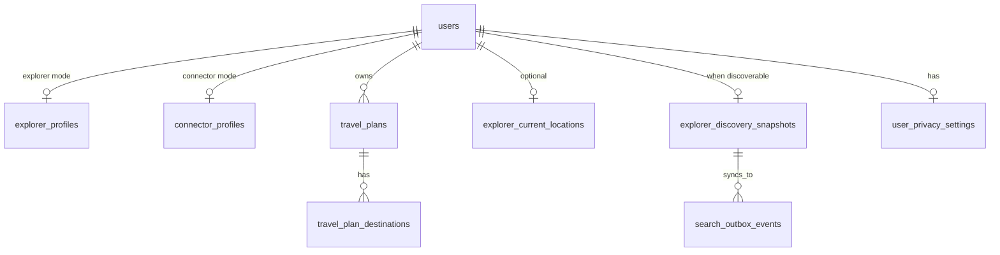

# Explorer / Connector Domain Model

ConnectCarry uses two business account modes. They are stored in `users.account_mode` and are distinct from Keycloak security roles/capabilities.

## Roles

### Explorer

Seeks access to people, places, products, opportunities, experiences, local knowledge, and business networks.

- **account_mode:** `explorer`
- **Typical capability:** `trip:create`
- **Profile table:** `explorer_profiles`
- **Primary API surface:** `/v1/explorers/*` (profile, trips, current location)
- **Discoverability:** Can appear in search when profile, trip, privacy, and availability allow

### Connector

Enables access for others through local knowledge, recommendations, introductions, and related facilitation.

- **account_mode:** `connector`
- **Typical capability:** `trip:join`
- **Profile table:** `connector_profiles` (search preferences; HTTP router planned)
- **Primary API surface:** `/v1/explorers/search` (browse discoverable explorers)

There is no `receiver` role in this domain.

## Terminology mapping (legacy → current)

| Legacy | Current |
| --- | --- |
| `traveler` | `explorer` |
| `messenger` | `connector` |
| `receiver` | *(removed — not used)* |

## Permissions model

| Capability | Intended role | Example endpoints |
| --- | --- | --- |
| `trip:create` | Explorer | `PUT /v1/explorers/profile`, `POST /v1/explorers/trips`, `PUT /v1/explorers/location` |
| `trip:join` | Connector | `GET /v1/explorers/search` |

Account mode gates explorer-only profile routes: connectors receive **403** on `GET/PUT /v1/explorers/profile`.

## User journeys

### Explorer — become discoverable

1. Sign up and verify email
2. Complete onboarding with `account_mode: explorer`
3. `PUT /v1/explorers/profile` — creates `explorer_profiles` row
4. `POST /v1/explorers/trips` — sets destination context
5. Optional `PUT /v1/explorers/location` — current location for filters
6. System rebuilds `explorer_discovery_snapshots` and enqueues Meilisearch sync

### Connector — find explorers

1. Sign up / onboarding with `account_mode: connector`
2. `GET /v1/explorers/search?destination_country=XX` with `trip:join`
3. Send connection request via `/v1/connections/*`

## Entity relationships

## Key SQL functions

| Function | Purpose |
| --- | --- |
| `fn_explorer_profiles` | Get/upsert explorer profile; upsert triggers snapshot rebuild |
| `fn_connector_profiles` | Get/upsert connector preferences |
| `fn_explorer_current_locations` | Get/upsert current location; rebuild snapshot |
| `social_rebuild_discovery_snapshot` | Denormalize discoverable explorer card |
| `fn_discovery_snapshots` | Rebuild, get, search, fetch-by-ids |

## Related documentation

- [profile-api.md](./profile-api.md) — identity and profile lifecycle
- [explorers-api.md](./explorers-api.md) — HTTP API for explorers routes
- [role-migration-plan.md](./role-migration-plan.md) — deployment and rollback
