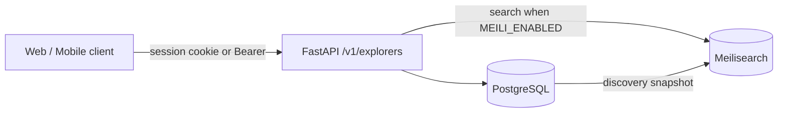
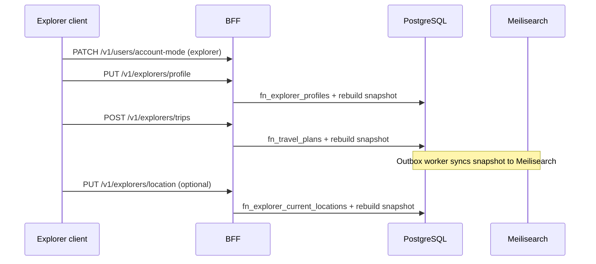
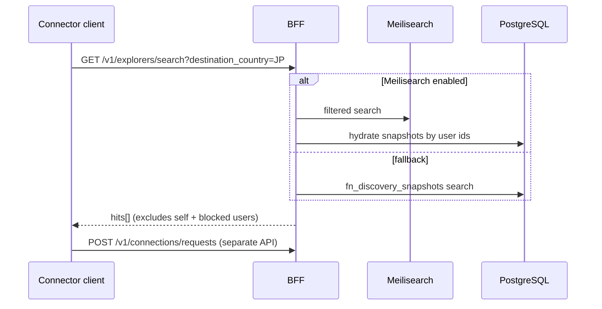

# Explorers API — End-to-End Guide

This document describes the **Explorers** HTTP API exposed at `/v1/explorers/*`. It covers authentication, authorization, request/response shapes, database side effects, search behavior, and how the ConnectCarry frontend uses these endpoints.

For the full **profile lifecycle** (signup → onboarding → account mode → explorer profile identity split), see [profile-api.md](./profile-api.md).

**Source:** [`v1/routers/explorers.py`](../v1/routers/explorers.py)

---

## Overview

The explorers API lets users:

1. **Maintain an explorer profile** (headline, bio, languages, visibility, etc.)
2. **Create travel plans** with one or more destination countries/cities
3. **Update current location** (country, city, coordinates)
4. **Search discoverable explorers** heading to a destination country (for connectors)

Profile, trip, and location writes rebuild a **discovery snapshot** in Postgres (`explorer_discovery_snapshots`). When Meilisearch is enabled, a background outbox syncs snapshots into the `explorers` search index for fast filtered search.




---

## Prerequisites

### Authentication

All endpoints require an authenticated principal. The BFF accepts either:

- **Session cookie** (`pp_session`) from the web app — set after sign-in; includes CSRF double-submit for `POST`/`PUT`/`PATCH`/`DELETE`
- **Bearer JWT** — Keycloak access token in `Authorization: Bearer <token>`

The auth middleware attaches `KeycloakPrincipal` to `request.state` before the router runs.

### Local user record

Every handler resolves the Keycloak subject (`principal.sub`) to a row in `users` via `PostgresUserRepository.get_by_keycloak_sub`. If no local user exists, the API returns **404 User not found**.

### Account mode

Profile, trip, location, and privacy routes require `account_mode=explorer`. Search requires `account_mode=connector`.


| `users.account_mode` | Explorer routes (`/profile`, `/trips`, `/location`, `/privacy`) | `GET /search` | Connector `/v1/connectors/profile` |
| -------------------- | --------------------------------------------------------------- | ------------- | ---------------------------------- |
| `explorer`           | Allowed (with capability where noted)                           | **403**       | **403**                            |
| `connector`          | **403**                                                         | Allowed       | Allowed                            |


Set account mode via `PATCH /v1/users/account-mode` after onboarding. The update bootstraps the required profile row in the same database transaction.

### Capabilities (Keycloak client roles)


| Endpoint        | Required capability | Account mode | Notes                                 |
| --------------- | ------------------- | ------------ | ------------------------------------- |
| `GET /profile`  | Authenticated only  | `explorer`   |                                       |
| `PUT /profile`  | `trip:create`       | `explorer`   |                                       |
| `GET /privacy`  | Authenticated only  | `explorer`   |                                       |
| `PUT /privacy`  | `trip:create`       | `explorer`   |                                       |
| `POST /trips`   | `trip:create`       | `explorer`   |                                       |
| `PUT /location` | `trip:create`       | `explorer`   |                                       |
| `GET /search`   | `trip:join`         | `connector`  | Typical for connector role            |


Users with the `admin` role bypass capability checks.

Default signup roles are configured in `config.yaml` / `AUTH_DEFAULT_SIGNUP_ROLES`. Ensure Keycloak assigns `trip:create` to explorers and `trip:join` to connectors (see [keycloak-setup-guide.md](./keycloak-setup-guide.md)).

---

## Endpoint reference

Base path: `**/v1/explorers`**

### GET `/profile`

Return the authenticated user's explorer profile.

**Auth:** Session or Bearer  
**Capability:** None  
**Account mode:** `explorer`

**Success — 200**

```json
{
  "user_id": "5e5f5aec-dd15-42c1-b9d2-8588a387883d",
  "headline": "Flying Tokyo → NYC in March",
  "bio": "Happy to carry small items.",
  "avatar_url": null,
  "home_country_id": 840,
  "home_state_id": null,
  "home_city_id": null,
  "custom_home_country_name": null,
  "custom_home_state_name": null,
  "custom_home_city_name": null,
  "display_home_country": "United States",
  "display_home_state": null,
  "display_home_city": null,
  "languages": ["en", "ja"],
  "interests": ["electronics", "books"],
  "connection_availability": "open",
  "visibility": "discoverable",
  "last_active_at": "2026-06-10T04:00:00Z"
}
```

**Errors**


| Status | When                                       |
| ------ | ------------------------------------------ |
| 401    | Not authenticated                          |
| 403    | Account mode is `connector` only           |
| 404    | Local user or explorer profile row missing |


---

### PUT `/profile`

Create or update the explorer profile. Only fields present in the body are applied (partial update via `exclude_unset`).

**Auth:** Session or Bearer  
**Capability:** `trip:create`  
**Account mode:** `explorer`

**Request body** (`[ExplorerProfileUpdateRequest](../v1/schemas/explorers.py)`)


| Field | Type | Constraints |
| ----- | ---- | ----------- |
| `headline`, `bio`, `avatar_url` | string | optional |
| `home_country_id`, `home_state_id`, `home_city_id` | int | optional; mutually exclusive with matching `custom_home_*_name` |
| `custom_home_country_name`, `custom_home_state_name`, `custom_home_city_name` | string | max 100/100/150 |
| `languages`, `interests` | string[] | optional |
| `connection_availability` | enum | `open`, `limited`, `unavailable` |
| `visibility` | enum | `discoverable`, `connections_only`, `hidden` |

See [profile-api.md](./profile-api.md) for location validation rules and the full request/response lifecycle.


**Example**

```bash
curl -X PUT "http://localhost:8000/v1/explorers/profile" \
  -H "Content-Type: application/json" \
  -H "Cookie: pp_session=..." \
  -H "X-CSRF-Token: ..." \
  -d '{
    "headline": "NRT → JFK, flexible dates",
    "languages": ["en"],
    "interests": ["snacks"],
    "visibility": "discoverable",
    "connection_availability": "open"
  }'
```

**Success — 200** — Same shape as `GET /profile`.

**Side effects**

- Upserts `explorer_profiles` via `fn_explorer_profiles` mode 2
- Ensures `user_privacy_settings` row exists
- Calls `social_rebuild_discovery_snapshot(user_id)` so search index data stays current

**Logs**

- `Explorer profile upsert request received`
- `Explorer profile upsert committed`

---

### POST `/trips`

Create a travel plan with one or more ordered destinations.

**Auth:** Session or Bearer  
**Capability:** `trip:create`

**Request body** (`[TravelPlanCreateRequest](../v1/schemas/explorers.py)`)


| Field          | Type                | Required       |
| -------------- | ------------------- | -------------- |
| `title`        | string              | optional       |
| `start_date`   | date (`YYYY-MM-DD`) | optional       |
| `end_date`     | date                | optional       |
| `is_primary`   | boolean             | default `true` |
| `destinations` | array               | **min 1 item** |


Each destination:


| Field            | Type                    |
| ---------------- | ----------------------- |
| `country_iso`    | 2-letter ISO (required) |
| `city_id`        | UUID (optional)         |
| `arrival_date`   | date (optional)         |
| `departure_date` | date (optional)         |


**Example**

```bash
curl -X POST "http://localhost:8000/v1/explorers/trips" \
  -H "Content-Type: application/json" \
  -H "Cookie: pp_session=..." \
  -H "X-CSRF-Token: ..." \
  -d '{
    "title": "Spring Japan trip",
    "start_date": "2026-03-01",
    "end_date": "2026-03-20",
    "is_primary": true,
    "destinations": [
      {
        "country_iso": "JP",
        "city_id": "550e8400-e29b-41d4-a716-446655440000",
        "arrival_date": "2026-03-05",
        "departure_date": "2026-03-15"
      }
    ]
  }'
```

**Success — 201**

```json
{
  "plan": {
    "id": "...",
    "user_id": "...",
    "title": "Spring Japan trip",
    "start_date": "2026-03-01",
    "end_date": "2026-03-20",
    "is_primary": true,
    "status": "active",
    "created_at": "...",
    "updated_at": "..."
  }
}
```

**Side effects**

- Inserts `travel_plans` and `travel_plan_destinations` via `fn_travel_plans` mode 2
- Rebuilds discovery snapshot for the user

**Logs**

- `Travel plan create request received`
- `Travel plan created`

---

### PUT `/location`

Update the explorer's current location (manual source by default).

**Auth:** Session or Bearer  
**Capability:** `trip:create`

**Request body** (`[CurrentLocationUpdateRequest](../v1/schemas/explorers.py)`)


| Field         | Type                    |
| ------------- | ----------------------- |
| `country_iso` | 2-letter ISO (optional) |
| `city_id`     | UUID (optional)         |
| `latitude`    | float (optional)        |
| `longitude`   | float (optional)        |


**Example**

```bash
curl -X PUT "http://localhost:8000/v1/explorers/location" \
  -H "Content-Type: application/json" \
  -H "Cookie: pp_session=..." \
  -H "X-CSRF-Token: ..." \
  -d '{
    "country_iso": "JP",
    "latitude": 35.6762,
    "longitude": 139.6503
  }'
```

**Success — 200**

```json
{
  "location": {
    "user_id": "...",
    "country_iso": "JP",
    "city_id": null,
    "latitude": "35.6762",
    "longitude": "139.6503",
    "source": "manual",
    "updated_at": "..."
  }
}
```

**Side effects**

- Upserts `explorer_current_locations` via `fn_explorer_current_locations` mode 2
- Rebuilds discovery snapshot

---

### GET `/search`

Search **discoverable** explorers by destination country. Intended for connectors browsing routes.

**Auth:** Session or Bearer  
**Capability:** `trip:join`

**Query parameters**


| Param                 | Required | Description                                               |
| --------------------- | -------- | --------------------------------------------------------- |
| `destination_country` | **Yes**  | 2-letter ISO (e.g. `JP`)                                  |
| `q`                   | No       | Full-text query (Meilisearch only)                        |
| `city_id`             | No       | Filter by destination city UUID                           |
| `current_country`     | No       | 2-letter ISO — filter explorers currently in this country |
| `limit`               | No       | 1–50, default 20                                          |
| `offset`              | No       | Pagination offset, default 0                              |


**Example**

```bash
curl "http://localhost:8000/v1/explorers/search?destination_country=JP&limit=20" \
  -H "Cookie: pp_session=..."
```

**Success — 200**

```json
{
  "hits": [
    {
      "user_id": "...",
      "display_name": "Alex",
      "headline": "NRT → JFK",
      "avatar_url": null,
      "destination_country_iso": "JP",
      "destination_city_name": "Tokyo",
      "current_country_iso": "US",
      "languages": ["en"],
      "interests": ["snacks"],
      "connection_availability": "open",
      "last_active_at": "2026-06-10T03:00:00Z"
    }
  ],
  "total": 1,
  "limit": 20,
  "offset": 0
}
```

**Search pipeline**

1. Resolve viewer's local `user_id` (excluded from results).
2. **If `MEILI_ENABLED=true` (default):**
  - Query Meilisearch index (`MEILI_EXPLORER_INDEX`, default `explorers`) with filters:
    - `destination_country`, `visibility = discoverable`, `availability != unavailable`
    - Optional `destination_city`, `current_country`
  - Hydrate hit IDs from `explorer_discovery_snapshots` via `fn_discovery_snapshots` mode 4.
3. **If Meilisearch disabled:**
  - Postgres fallback via `fn_discovery_snapshots` mode 3 (same discoverability + block rules).
4. Drop blocked pairs (`user_blocks`) and missing snapshots.
5. Map rows to `ExplorerSearchResult`.

**Logs**

- `Explorer search request received`
- `Explorer search completed` (includes `hit_count`, `total`)

---

## End-to-end flows

### Flow A — Explorer becomes discoverable




Minimum for search visibility:

- `account_mode` = `explorer`
- Profile `visibility = discoverable` and `connection_availability != unavailable`
- At least one active travel plan destination matching the searched country
- Discovery snapshot rebuilt (automatic on writes above)

### Flow B — Connector finds explorers




Frontend: `[SearchExplorersPage](../../connect-carry/src/app/search/pages/SearchExplorersPage.tsx)` → `explorers.search()` in `[src/lib/bff.ts](../../connect-carry/src/lib/bff.ts)`.

Trip creation from UI: `[TripsPage](../../connect-carry/src/app/trips/pages/TripsPage.tsx)` → `explorers.createTrip()`.

---

## Frontend client (`connect-carry`)

The BFF wrapper lives in `src/lib/bff.ts`:


| Client method                    | HTTP                           |
| -------------------------------- | ------------------------------ |
| `explorers.getProfile()`         | `GET /v1/explorers/profile`    |
| `explorers.updateProfile(data)`  | `PUT /v1/explorers/profile`    |
| `explorers.createTrip(data)`     | `POST /v1/explorers/trips`     |
| `explorers.updateLocation(data)` | `PUT /v1/explorers/location`   |
| `explorers.search(params)`       | `GET /v1/explorers/search?...` |


Base URL: `VITE_BACKEND_URL` (default `http://localhost:8000`).

**Note:** The API search response uses `{ hits, total, limit, offset }`. Ensure the frontend client maps `hits` correctly when integrating (see `ExplorerSearchResponse` in the backend schema).

---

## Configuration


| Variable               | Default                 | Purpose                                                    |
| ---------------------- | ----------------------- | ---------------------------------------------------------- |
| `MEILI_ENABLED`        | `true`                  | Use Meilisearch for search; `false` uses Postgres fallback |
| `MEILI_URL`            | `http://localhost:7700` | Meilisearch host                                           |
| `MEILI_MASTER_KEY`     | (dev key)               | API key                                                    |
| `MEILI_EXPLORER_INDEX` | `explorers`             | Index UID                                                  |


Readiness: `GET /health/ready` checks Meilisearch when enabled.

---

## Data layer reference


| Postgres function               | Mode                          | Used by         |
| ------------------------------- | ----------------------------- | --------------- |
| `fn_explorer_profiles`          | 1 get, 2 upsert+rebuild       | Profile GET/PUT |
| `fn_travel_plans`               | 2 create+destinations+rebuild | POST `/trips`   |
| `fn_explorer_current_locations` | 2 upsert+rebuild              | PUT `/location` |
| `fn_discovery_snapshots`        | 3 search, 4 fetch by ids      | GET `/search`   |


Key tables: `explorer_profiles`, `travel_plans`, `travel_plan_destinations`, `explorer_current_locations`, `explorer_discovery_snapshots`, `user_blocks`.

---

## Error quick reference


| HTTP | Typical cause                                                                    |
| ---- | -------------------------------------------------------------------------------- |
| 401  | Missing/invalid session or Bearer token                                          |
| 403  | Missing `trip:create` / `trip:join`, or connector-only account on profile routes |
| 404  | No local `users` row, or explorer profile not created yet on GET                 |
| 422  | Validation error (invalid ISO length, empty destinations array, etc.)            |


---

## Local testing checklist

1. Start stack: Postgres, Redis, Keycloak, Meilisearch (see root [README.md](../README.md)).
2. Run migrations: `uv run python scripts/run_migrations.py`
3. Sign up / sign in as a **explorer**.
4. `PUT /profile` → `POST /trips` with `destinations[].country_iso`.
5. Sign in as a **connector** with `trip:join`.
6. `GET /search?destination_country=<ISO>` — confirm explorer appears (may require outbox sync if Meilisearch lagging).
7. Confirm blocked users and `visibility: hidden` profiles do not appear.

---

## Related documentation

- [auth-architecture.md](./auth-architecture.md) — sessions, capabilities, account lifecycle
- [keycloak-setup-guide.md](./keycloak-setup-guide.md) — client roles (`trip:create`, `trip:join`)
- [configuration-guide.md](./configuration-guide.md) — env loading
- [README.md](../README.md) — full API index and middleware order
