# Migration Dependency Graph

Consolidated migration order and object dependencies for the chatapp PostgreSQL schema.

## File Execution Order

```
001_extensions.sql
    └── pgcrypto, pg_trgm
002_tables.sql
    └── 23 tables, indexes, CHECK/UNIQUE constraints
003_functions_core.sql
    └── set_updated_at, fn_health, fn_tinode_user_mappings, fn_signup_sessions, fn_users
004_functions_social.sql
    └── social_* helpers, fn_explorer_*, fn_discovery_*, fn_connection_*, fn_search_outbox_events
005_functions_chat.sql
    └── fn_tinode_conversation_mappings (depends on user_connections, user_blocks, users, tinode_user_mappings)
006_triggers.sql
    └── 10 triggers → set_updated_at()
007_seeds_geo.sql
    └── geo_countries, geo_cities reference data
```

## Mermaid: Object Layers

```mermaid
flowchart TB
    subgraph L1["001 Extensions"]
        EXT_PGCRYPTO[pgcrypto]
        EXT_PGTRGM[pg_trgm]
    end

    subgraph L2["002 Tables — Identity"]
        users[users]
        tum[tinode_user_mappings]
    end

    subgraph L3["002 Tables — Auth"]
        oauth[oauth_signin_states]
        sessions[auth_sessions]
        sec_events[auth_security_events]
        fingerprints[auth_device_fingerprints]
        idem[auth_idempotency_keys]
        outbox_auth[auth_outbox_events]
        signup_sess[signup_sessions]
    end

    subgraph L4["002 Tables — Geo"]
        countries[geo_countries]
        cities[geo_cities]
    end

    subgraph L5["002 Tables — Profiles & Travel"]
        tp[explorer_profiles]
        mp[connector_profiles]
        privacy[user_privacy_settings]
        plans[travel_plans]
        dests[travel_plan_destinations]
        loc[explorer_current_locations]
    end

    subgraph L6["002 Tables — Social & Chat"]
        snap[explorer_discovery_snapshots]
        conn_req[connection_requests]
        conn[user_connections]
        blocks[user_blocks]
        tinode_map[tinode_conversation_mappings]
        search_ob[search_outbox_events]
    end

    subgraph L7["003–005 Functions"]
        fn_users[fn_users]
        fn_signup[fn_signup_sessions]
        fn_tum[fn_tinode_user_mappings]
        fn_social[social_rebuild_discovery_snapshot]
        fn_disc[fn_discovery_snapshots]
        fn_chat[fn_tinode_conversation_mappings]
    end

    subgraph L8["006 Triggers"]
        trg[set_updated_at triggers ×10]
    end

    subgraph L9["007 Seeds"]
        seeds[geo seed rows]
    end

    EXT_PGCRYPTO --> users
    EXT_PGTRGM --> cities
    users --> tum
    users --> oauth
    users --> sessions
    users --> sec_events
    users --> fingerprints
    users --> signup_sess
    countries --> cities
    users --> tp
    users --> mp
    users --> privacy
    countries --> tp
    cities --> tp
    users --> plans
    plans --> dests
    countries --> dests
    cities --> dests
    users --> loc
    users --> snap
    users --> conn_req
    users --> conn
    users --> blocks
    conn --> tinode_map
    users --> search_ob

    fn_users --> users
    fn_signup --> signup_sess
    fn_tum --> tum
    fn_social --> snap
    fn_social --> search_ob
    fn_disc --> snap
    fn_chat --> tinode_map
    fn_chat --> conn
    fn_chat --> blocks

    trg --> users
    trg --> tum
    trg --> sessions
    trg --> fingerprints
    trg --> tp
    trg --> mp
    trg --> privacy
    trg --> plans
    trg --> conn_req
    trg --> tinode_map

    seeds --> countries
    seeds --> cities
```



## Table FK Dependency List

| Table | Depends on |
|-------|------------|
| `tinode_user_mappings` | `users` |
| `oauth_signin_states` | — |
| `auth_sessions` | `users` |
| `auth_security_events` | `users` (nullable) |
| `auth_device_fingerprints` | `users` |
| `auth_idempotency_keys` | — |
| `auth_outbox_events` | — |
| `signup_sessions` | `users` |
| `geo_cities` | `geo_countries` |
| `explorer_profiles` | `users`, `geo_countries`, `geo_cities` |
| `connector_profiles` | `users`, `geo_countries`, `geo_cities` |
| `user_privacy_settings` | `users` |
| `travel_plans` | `users` |
| `travel_plan_destinations` | `travel_plans`, `geo_countries`, `geo_cities` |
| `explorer_current_locations` | `users`, `geo_countries`, `geo_cities` |
| `explorer_discovery_snapshots` | `users` |
| `connection_requests` | `users` ×2 |
| `user_connections` | `users` ×2, `connection_requests` (nullable) |
| `user_blocks` | `users` ×2 |
| `tinode_conversation_mappings` | `user_connections`, `users` (nullable) |
| `search_outbox_events` | — |

## Function Dependency List

| Function | Reads/writes |
|----------|--------------|
| `set_updated_at` | trigger only |
| `fn_health` | `now()` |
| `fn_users` | `users` |
| `fn_tinode_user_mappings` | `tinode_user_mappings`, `users` |
| `fn_signup_sessions` | `signup_sessions` |
| `social_ordered_pair` | — |
| `social_enqueue_search_outbox` | `search_outbox_events` |
| `social_rebuild_discovery_snapshot` | `users`, profiles, privacy, locations, plans, `explorer_discovery_snapshots`, outbox |
| `social_expire_connection_request` | `connection_requests` |
| `fn_explorer_profiles` | `explorer_profiles`, `user_privacy_settings` + rebuild |
| `fn_connector_profiles` | `connector_profiles` |
| `fn_user_privacy_settings` | `user_privacy_settings` + rebuild |
| `fn_travel_plans` | `travel_plans`, `travel_plan_destinations` + rebuild |
| `fn_explorer_current_locations` | `explorer_current_locations` + rebuild |
| `fn_discovery_snapshots` | `explorer_discovery_snapshots`, `user_blocks` |
| `fn_connection_requests` | `connection_requests`, `user_connections`, `user_blocks` |
| `fn_user_connections` | `user_connections` |
| `fn_user_blocks` | `user_blocks` |
| `fn_search_outbox_events` | `search_outbox_events` |
| `fn_tinode_conversation_mappings` | `tinode_conversation_mappings`, `user_connections`, `users`, `user_blocks`, `tinode_user_mappings` |

## Enums / Views / Procedures

- **Enums:** none (status fields use `TEXT` + `CHECK` constraints)
- **Views:** none
- **Procedures:** none (`LANGUAGE plpgsql` functions only)
