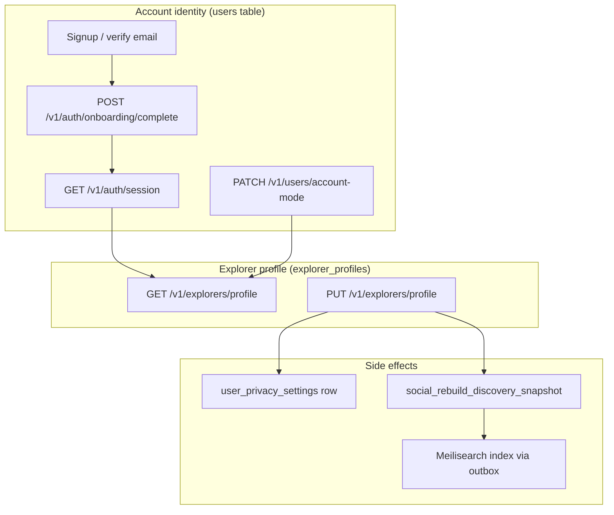
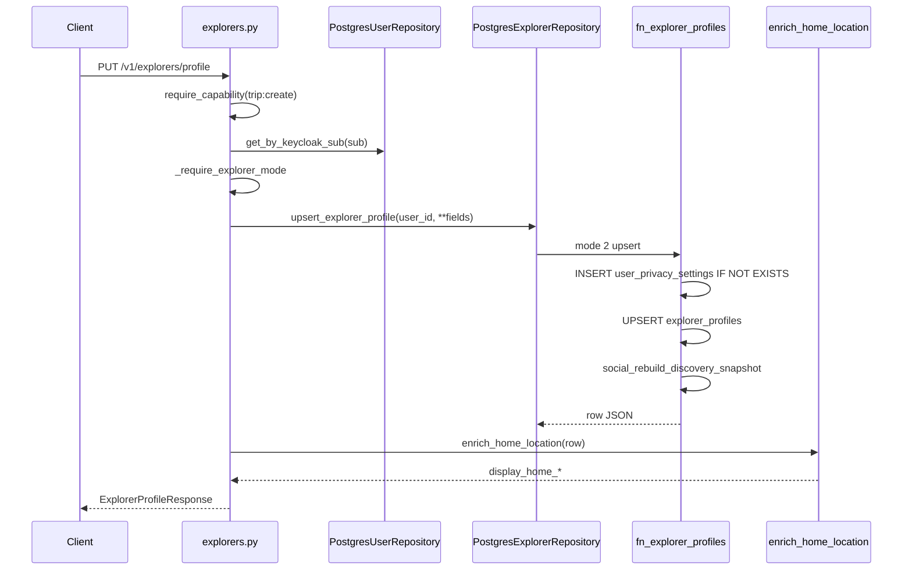

# Profile API — End-to-End Guide

This document explains how **user identity** and **role-specific profiles** work across the ConnectCarry backend: from signup through onboarding, account mode, explorer profile read/write, and account deletion.

For trips, current location, and explorer search, see [explorers-api.md](./explorers-api.md).

**Primary source files**

| Layer | Path |
| ----- | ---- |
| Explorer profile routes | [`v1/routers/explorers.py`](../v1/routers/explorers.py) |
| Account / mode routes | [`v1/routers/users.py`](../v1/routers/users.py) |
| Auth / onboarding routes | [`v1/routers/auth.py`](../v1/routers/auth.py) |
| Explorer schemas | [`v1/schemas/explorers.py`](../v1/schemas/explorers.py) |
| User schemas | [`v1/schemas/users.py`](../v1/schemas/users.py) |
| Explorer repository | [`infrastructure/database/repositories/explorers.py`](../infrastructure/database/repositories/explorers.py) |
| User repository | [`infrastructure/database/repositories/users.py`](../infrastructure/database/repositories/users.py) |
| Location validation | [`domains/geo/location_payload.py`](../domains/geo/location_payload.py) |
| Display enrichment | [`domains/geo/display.py`](../domains/geo/display.py) |
| DB functions | [`migrations/003_functions_core.sql`](../migrations/003_functions_core.sql) (`fn_users`), [`migrations/004_functions_social.sql`](../migrations/004_functions_social.sql) (`fn_explorer_profiles`) |

---

## What “profile” means in this codebase

Profile data is split across two concerns:

1. **Account identity** — stored on `users`: email, display name, status, `account_mode` (`explorer` | `connector`). Managed via auth and users routes. Synced to Keycloak display name on onboarding.
2. **Role-specific profile** — stored in separate tables:
   - **Explorer:** `explorer_profiles` — headline, bio, home location, languages, visibility, etc. Exposed at `GET/PUT /v1/explorers/profile`.
   - **Connector:** `connector_profiles` — home location, preferred destinations, last search location, bio. Repository + SQL function exist; **no public HTTP router yet**.

Onboarding sets identity (`display_name`, `account_mode`) but does **not** create a `explorer_profiles` row. The first successful `PUT /v1/explorers/profile` creates that row.



---

## Lifecycle: signup → onboarding → profile

### 1. Signup and verification

Email signup creates a local `users` row in `pending_verification` (`fn_users` mode 7). After Keycloak email verification and first sign-in, the user moves to `pending_profile_setup` (auth service activation flow).

At this stage the user has **no** `account_mode` finalized for app use and **no** explorer/connector profile row.

### 2. Onboarding (identity + role)

**`POST /v1/auth/onboarding/complete`**

| | |
| --- | --- |
| **Auth** | Session cookie or Bearer JWT |
| **Body** | `display_name` (1–120 chars), `account_mode`: `explorer` \| `connector` |
| **Precondition** | `users.status` must be `pending_profile_setup` |
| **Effect** | `fn_users` mode 13: sets `display_name`, `account_mode`, `onboarding_completed_at`, `status = active` |
| **Keycloak** | Updates Keycloak user display name |
| **Outbox** | `signup.onboarding_completed` event |

Handler: [`v1/routers/auth.py`](../v1/routers/auth.py) → `AuthService.complete_onboarding` → [`domains/auth/service.py`](../domains/auth/service.py).

This step does **not** insert into `explorer_profiles` or `connector_profiles`.

### 3. Session bootstrap

**`GET /v1/auth/session`**

Returns the current `UserResponse` (id, email, display_name, status, account_mode, etc.). Calls `BootstrapUser`, which upserts the local user via `fn_users` mode 1 if missing (e.g. legacy Keycloak users).

Used by the frontend to hydrate auth state after page load.

### 4. Explorer profile create/read/update

Only when `account_mode === "explorer"`:

| Method | Path | Capability | Creates row? |
| ------ | ---- | ---------- | ------------ |
| `GET` | `/v1/explorers/profile` | Authenticated only | No — 404 if row missing |
| `PUT` | `/v1/explorers/profile` | `trip:create` | Yes — upsert via `fn_explorer_profiles` mode 2 |

Connectors calling these endpoints receive **403** with `Explorer profile requires account_mode explorer`.

### 5. Switching account mode

**`PATCH /v1/users/account-mode`**

| | |
| --- | --- |
| **Body** | `{ "account_mode": "explorer" \| "connector" }` |
| **Auth** | Authenticated only (no `profile:update` capability required) |
| **Effect** | `fn_users` mode 5 updates `users.account_mode` |

Switching mode does not delete existing profile rows; it only changes which HTTP APIs are allowed.

### 6. Account deletion

**`DELETE /v1/users/me`**

| | |
| --- | --- |
| **Capability** | `profile:update` |
| **Effect** | Deletes Keycloak user, then local `users` row (`fn_users` mode 14). CASCADE removes `explorer_profiles`, `connector_profiles`, trips, etc. |

---

## Authentication

All endpoints require a valid principal:

- **Web:** session cookie `pp_session` (CSRF header required on mutating requests)
- **API clients:** `Authorization: Bearer <Keycloak access token>`

Middleware resolves `KeycloakPrincipal` (`sub`, email, roles/capabilities). See [auth-architecture.md](./auth-architecture.md).

Every handler that touches profile data first resolves `principal.sub` → local user via `PostgresUserRepository.get_by_keycloak_sub`. Missing local user → **404 User not found**.

---

## Explorer profile HTTP API

Base path: **`/v1/explorers`**

### GET `/profile`

Returns the authenticated explorer’s profile plus computed display names for home location.

**Gates:** `account_mode = explorer`, profile row must exist.

**Response** (`ExplorerProfileResponse`):

| Field | Type | Notes |
| ----- | ---- | ----- |
| `user_id` | UUID | Same as `users.id` |
| `headline`, `bio`, `avatar_url` | string \| null | |
| `home_country_id`, `home_state_id`, `home_city_id` | int \| null | FKs into `geo_*` tables |
| `custom_home_country_name`, `custom_home_state_name`, `custom_home_city_name` | string \| null | Free-text when geo ID not used |
| `display_home_country`, `display_home_state`, `display_home_city` | string \| null | **Read-only**, resolved server-side |
| `languages`, `interests` | string[] | Default `[]` |
| `connection_availability` | string | `open` \| `limited` \| `unavailable` |
| `visibility` | string | `discoverable` \| `connections_only` \| `hidden` |
| `last_active_at` | datetime \| null | Updated on profile upsert |

**Example (200)**

```json
{
  "user_id": "5e5f5aec-dd15-42c1-b9d2-8588a387883d",
  "headline": "Flying Tokyo → NYC in March",
  "bio": "Happy to carry small items.",
  "avatar_url": null,
  "home_country_id": 840,
  "home_state_id": 1456,
  "home_city_id": null,
  "custom_home_country_name": null,
  "custom_home_state_name": null,
  "custom_home_city_name": null,
  "display_home_country": "United States",
  "display_home_state": "California",
  "display_home_city": null,
  "languages": ["en", "ja"],
  "interests": ["electronics", "books"],
  "connection_availability": "open",
  "visibility": "discoverable",
  "last_active_at": "2026-06-10T04:00:00Z"
}
```

**Errors**

| Status | Condition |
| ------ | --------- |
| 401 | Not authenticated |
| 403 | `account_mode` is not `explorer` |
| 404 | Local user or `explorer_profiles` row missing |

### PUT `/profile`

Partial update: only fields sent in the JSON body are applied (`model_dump(exclude_unset=True)` in the router).

**Gates:** `account_mode = explorer`, capability **`trip:create`**.

**Request body** (`ExplorerProfileUpdateRequest`) — all fields optional:

| Field | Constraints |
| ----- | ----------- |
| `headline`, `bio`, `avatar_url` | optional strings |
| `home_country_id`, `home_state_id`, `home_city_id` | optional integers |
| `custom_home_*_name` | max 100/100/150 chars; cannot be set together with matching `home_*_id` |
| `languages`, `interests` | string arrays; omit to leave unchanged |
| `connection_availability` | `open` \| `limited` \| `unavailable` |
| `visibility` | `discoverable` \| `connections_only` \| `hidden` |

**Location validation:** Pydantic runs `LocationFields` mutual-exclusion rules — for each level (country/state/city), you may set either a geo **ID** or a **custom name**, not both. Empty custom strings are rejected.

**Example**

```bash
curl -X PUT "http://localhost:8000/v1/explorers/profile" \
  -H "Content-Type: application/json" \
  -H "Cookie: pp_session=..." \
  -H "X-CSRF-Token: ..." \
  -d '{
    "headline": "NRT → JFK, flexible dates",
    "home_country_id": 840,
    "home_state_id": 1456,
    "languages": ["en"],
    "interests": ["snacks"],
    "visibility": "discoverable",
    "connection_availability": "open"
  }'
```

**Response:** Same shape as `GET /profile` (200).

**Errors**

| Status | Condition |
| ------ | --------- |
| 401 | Not authenticated |
| 403 | Wrong account mode or missing `trip:create` |
| 404 | Local user missing |
| 422 | Invalid location payload (ID + custom name conflict) |

---

## Request path (explorer profile)



### GET path

Same as above except: no capability check, `fn_explorer_profiles` mode 1 (SELECT only), 404 if no row.

---

## Database layer

### Tables

**`users`** — account identity ([`migrations/002_tables.sql`](../migrations/002_tables.sql))

| Column | Role in profile flow |
| ------ | -------------------- |
| `keycloak_sub` | Link to Keycloak subject |
| `display_name` | Set at onboarding; shown in search |
| `account_mode` | `explorer` \| `connector` — gates explorer profile routes |
| `status` | `pending_profile_setup` → `active` after onboarding |
| `onboarding_completed_at` | Set by `fn_users` mode 13 |

**`explorer_profiles`** — one row per explorer user (PK `user_id` → `users.id`)

Stores headline, bio, avatar, home location (IDs + custom names), languages, interests, `connection_availability`, `visibility`, timestamps.

**`user_privacy_settings`** — created automatically on first profile upsert (default allow flags for discovery/location/trip dates).

**`connector_profiles`** — parallel schema for connectors; managed by `fn_connector_profiles` in SQL, not yet exposed over HTTP.

### `fn_explorer_profiles` ([`004_functions_social.sql`](../migrations/004_functions_social.sql))

| Mode | Purpose |
| ---- | ------- |
| 1 | `SELECT` profile by `user_id` |
| 2 | Upsert profile + ensure privacy row + **`PERFORM social_rebuild_discovery_snapshot(uid)`** |

Mode 2 merge semantics:

- Omitted JSON keys → existing column values kept (on UPDATE).
- Present keys → overwrite (including explicit `null` for geo IDs via `payload ? 'home_country_id'` checks).
- `last_active_at` and `updated_at` set to `now()` on every upsert.

### Display name enrichment

After reading from Postgres, the router calls [`enrich_home_location()`](../domains/geo/display.py):

1. If `custom_home_*_name` is set → use it for `display_home_*`.
2. Else if `home_*_id` is set → lookup name from `geo_countries` / `geo_states` / `geo_cities`.

These display fields are **not** stored in `explorer_profiles`; they are computed per request.

### Discovery snapshot side effect

`social_rebuild_discovery_snapshot` aggregates:

- User + explorer profile + privacy settings
- Current location (`explorer_current_locations`)
- Primary active travel plan + first destination

It writes `explorer_discovery_snapshots`, which powers Postgres fallback search and (when enabled) Meilisearch indexing. Profile updates therefore affect discoverability without a separate “publish” call.

If `connection_availability` is null or `account_mode <> 'explorer'`, the snapshot marks the user non-discoverable.

---

## Capabilities and account mode

| Endpoint | Capability | Account mode |
| -------- | ---------- | ------------ |
| `GET /v1/auth/session` | Authenticated | Any |
| `POST /v1/auth/onboarding/complete` | Authenticated | `pending_profile_setup` |
| `PATCH /v1/users/account-mode` | Authenticated | Any active user |
| `GET /v1/explorers/profile` | Authenticated | `explorer` |
| `PUT /v1/explorers/profile` | `trip:create` | `explorer` |
| `DELETE /v1/users/me` | `profile:update` | Any |

Users with the `admin` role bypass capability checks.

Default signup roles in `config.yaml` / `AUTH_DEFAULT_SIGNUP_ROLES` typically include `trip:create` for explorers. See [keycloak-setup-guide.md](./keycloak-setup-guide.md).

---

## Account identity API (related)

### `UserResponse` shape

Returned by session, onboarding, and account-mode endpoints:

```json
{
  "id": "uuid",
  "keycloak_sub": "keycloak-subject-id",
  "email": "user@example.com",
  "display_name": "Jane Explorer",
  "status": "active",
  "account_mode": "explorer",
  "email_verified": true,
  "created_via": "email",
  "onboarding_completed_at": "2026-06-01T12:00:00Z",
  "tos_accepted_at": null,
  "created_at": "2026-06-01T11:00:00Z",
  "updated_at": "2026-06-01T12:00:00Z"
}
```

Display name and email are **not** updated through `PUT /v1/explorers/profile`; use onboarding (once) or future account-settings endpoints.

---

## Frontend mapping (ConnectCarry)

| UI / flow | Client module | Backend |
| --------- | ------------- | ------- |
| Role selection / onboarding | `auth.onboardingComplete()` → [`src/lib/api/auth.ts`](../../connect-carry/src/lib/api/auth.ts) | `POST /v1/auth/onboarding/complete` |
| Auth hydration | session fetch | `GET /v1/auth/session` |
| Settings → explorer profile | `explorers.getProfile()` / `explorers.updateProfile()` → [`src/lib/api/explorers.ts`](../../connect-carry/src/lib/api/explorers.ts) | `GET/PUT /v1/explorers/profile` |
| Switch explorer/connector | `users.updateAccountMode()` → [`src/lib/api/users.ts`](../../connect-carry/src/lib/api/users.ts) | `PATCH /v1/users/account-mode` |

Geo pickers on the frontend load reference data from `/v1/geo/*` and send numeric IDs (or custom names) in the profile PUT body.

---

## Connector profiles (backend only)

`PostgresExplorerRepository` also implements `get_connector_profile` / upsert via `fn_connector_profiles`. There is **no** `/v1/connectors/profile` router in the current codebase. Connector home/search preferences are intended to be exposed in a future API mirroring the explorer pattern.

---

## Operational notes

- **First-time explorers:** Expect `GET /profile` → 404 until the user saves settings once via `PUT /profile`.
- **Partial updates:** Send only changed fields; arrays replace entirely when included in the body (SQL `WHEN payload ? 'languages'` branch).
- **Clearing geo IDs:** Include `"home_city_id": null` in PUT body to clear a stored ID (SQL checks key presence).
- **Logging:** Profile upsert logs `Explorer profile upsert request received` and `Explorer profile upsert committed` with `request_id` and `user_id`.

---

## See also

- [explorers-api.md](./explorers-api.md) — trips, current location, search
- [auth-architecture.md](./auth-architecture.md) — sessions, CSRF, Keycloak
- [keycloak-setup-guide.md](./keycloak-setup-guide.md) — client roles and capabilities
