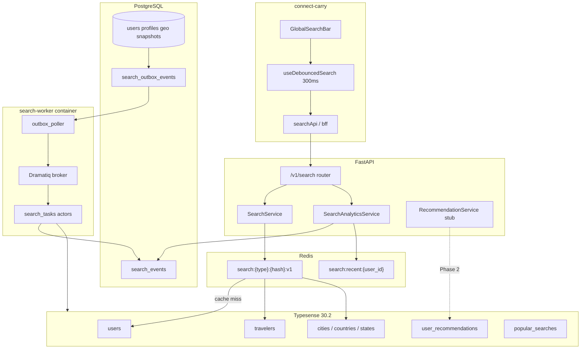
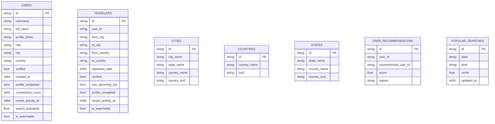
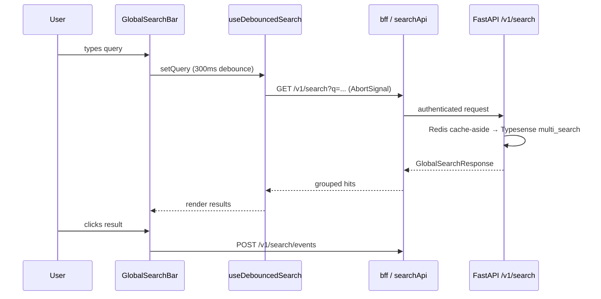

# Typesense Search Platform — End-to-End Guide

This document describes the complete **Typesense-backed search platform** for PariPath: architecture, database schema, indexing pipeline, API, caching, Docker, frontend integration, observability, and operational runbooks.

**Source code roots:**

| Area | Path |
|------|------|
| Typesense client & schemas | [`infrastructure/typesense/`](../infrastructure/typesense/) |
| Domain services | [`domains/search/`](../domains/search/) |
| HTTP API | [`v1/routers/search.py`](../v1/routers/search.py) |
| Schemas | [`v1/schemas/search.py`](../v1/schemas/search.py) |
| Redis cache | [`infrastructure/redis/search_cache.py`](../infrastructure/redis/search_cache.py) |
| Workers | [`workers/search_tasks.py`](../workers/search_tasks.py), [`workers/outbox_poller.py`](../workers/outbox_poller.py) |
| Rebuild CLI | [`scripts/rebuild_search_index.py`](../scripts/rebuild_search_index.py) |
| Frontend client | [`connect-carry/src/lib/api/search.ts`](../../connect-carry/src/lib/api/search.ts) |
| Global search UI | [`connect-carry/src/app/search/components/GlobalSearchBar.tsx`](../../connect-carry/src/app/search/components/GlobalSearchBar.tsx) |

---

## Overview

PariPath search is **Typesense-only on the hot path**. API routes never write to Typesense synchronously. Instead:

1. **PostgreSQL** is the source of truth for profiles, discovery snapshots, and geo data.
2. Profile/trip/privacy writes enqueue **`search_outbox_events`**.
3. A **Dramatiq search-worker** polls the outbox and upserts/deletes Typesense documents.
4. **FastAPI** serves `/v1/search/*` with cache-aside Redis + Typesense queries.
5. **Analytics** (clicks, impressions) land in **`search_events`** (Postgres) and optionally roll up to the **`popular_searches`** collection.

Chat message search remains on **Matrix/Synapse** ([`v1/routers/chat.py`](../v1/routers/chat.py)) — out of Typesense scope.



---

## Entity-Relationship Diagram (PostgreSQL)

Search-related Postgres tables and their relationships to core domain tables.

```mermaid
erDiagram
    users ||--o| explorer_profiles : has
    users ||--o| connector_profiles : has
    users ||--o| user_privacy_settings : has
    users ||--o| explorer_discovery_snapshots : "1 snapshot"
    users ||--o{ user_connections : participates
    users ||--o{ user_blocks : blocks
    users ||--o{ search_events : "analytics"
    users {
        uuid id PK
        text display_name
        text account_mode
        text status
        bool email_verified
        timestamptz onboarding_completed_at
        timestamptz last_active_at
    }

    explorer_profiles {
        uuid user_id PK FK
        text avatar_url
        text visibility
        bigint home_city_id FK
        char home_country_iso
        timestamptz updated_at
    }

    user_privacy_settings {
        uuid user_id PK FK
        bool allow_search_discovery
        bool show_current_location
        bool show_trip_dates
    }

    explorer_discovery_snapshots {
        uuid user_id PK FK
        text display_name
        text headline
        text avatar_url
        char destination_country_iso
        text destination_city_name
        char current_country_iso
        date trip_start_date
        text visibility
        bool is_discoverable
        timestamptz last_active_at
    }

    search_outbox_events {
        uuid id PK
        text aggregate_type
        uuid aggregate_id
        text event_type
        jsonb payload
        text status
        int attempts
        text last_error
        timestamptz scheduled_at
        timestamptz processed_at
    }

    search_events {
        uuid id PK
        uuid user_id FK
        text query
        text result_type
        text result_id
        bool clicked
        timestamptz created_at
    }

    geo_countries ||--o{ geo_states : contains
    geo_countries ||--o{ geo_cities : contains
    geo_states ||--o{ geo_cities : contains

    geo_countries {
        bigint id PK
        char iso2
        text name
    }

    geo_states {
        bigint id PK
        bigint country_id FK
        text name
        text state_code
    }

    geo_cities {
        bigint id PK
        bigint country_id FK
        bigint state_id FK
        text name
    }

    user_blocks {
        uuid blocker_id FK
        uuid blocked_id FK
    }

    user_connections {
        uuid id PK
        uuid user_a_id FK
        uuid user_b_id FK
        text status
    }
```

### Outbox vs analytics

| Table | Purpose | Written by |
|-------|---------|------------|
| `search_outbox_events` | Async index sync queue | `social_enqueue_search_outbox()` on snapshot rebuild |
| `search_events` | Query/click analytics | `POST /v1/search/events`, Dramatiq `record_search_event` |

These are **separate** from `auth_outbox_events` (Keycloak lifecycle).

---

## Typesense Collections

Seven collections are created idempotently on API startup via [`ensure_all_collections()`](../infrastructure/typesense/collections.py).



### Collection → Postgres source

| Collection | Env var (default) | Postgres source | Document mapper |
|------------|-------------------|-----------------|-----------------|
| `users` | `TYPESENSE_USERS_COLLECTION` | `users` + profiles + connections count | [`documents/users.py`](../infrastructure/typesense/documents/users.py) |
| `travelers` | `TYPESENSE_TRAVELERS_COLLECTION` | `explorer_discovery_snapshots` | [`documents/travelers.py`](../infrastructure/typesense/documents/travelers.py) |
| `cities` | `TYPESENSE_CITIES_COLLECTION` | `geo_cities` + joins | [`documents/cities.py`](../infrastructure/typesense/documents/cities.py) |
| `countries` | `TYPESENSE_COUNTRIES_COLLECTION` | `geo_countries` | [`documents/countries.py`](../infrastructure/typesense/documents/countries.py) |
| `states` | `TYPESENSE_STATES_COLLECTION` | `geo_states` + joins | [`documents/states.py`](../infrastructure/typesense/documents/states.py) |
| `user_recommendations` | `TYPESENSE_USER_RECOMMENDATIONS_COLLECTION` | Empty in Phase 1 | Schema only |
| `popular_searches` | `TYPESENSE_POPULAR_SEARCHES_COLLECTION` | Aggregated from `search_events` | [`documents/popular_searches.py`](../infrastructure/typesense/documents/popular_searches.py) |

### Index-time visibility rules

**Users** (`is_searchable = true` only when):

- `users.status = 'active'`
- Profile `visibility = 'discoverable'`
- `user_privacy_settings.allow_search_discovery = true`

**Travelers** (`is_searchable = true` only when):

- `is_discoverable = true` AND `visibility = 'discoverable'`
- Indexed document deleted when snapshot becomes non-discoverable

---

## Indexing Pipeline (Outbox → Dramatiq → Typesense)

```mermaid
sequenceDiagram
    participant App as Explorer API write
    participant PG as PostgreSQL
    participant Poller as outbox_poller
    participant DQ as Dramatiq
    participant Actor as search_tasks
    participant TS as Typesense

    App->>PG: social_rebuild_discovery_snapshot(user_id)
    PG->>PG: UPSERT explorer_discovery_snapshots
    alt discoverable
        PG->>PG: INSERT search_outbox_events (upsert)
    else hidden/suspended
        PG->>PG: INSERT search_outbox_events (delete)
    end

    loop every 5 seconds
        Poller->>PG: fn_search_outbox_events(mode=1) claim batch
        Poller->>DQ: index_traveler_document / delete_search_document
        DQ->>Actor: process message
        Actor->>PG: reload snapshot or user row
        Actor->>TS: upsert or delete document
        Poller->>PG: fn_search_outbox_events(mode=2) complete
    end
```

### Outbox event shape

| Column | Values |
|--------|--------|
| `aggregate_type` | `explorer_discovery_snapshot` (primary), `user`, `traveler` (supported in code) |
| `aggregate_id` | `user_id` UUID |
| `event_type` | `upsert` \| `delete` |
| `status` | `pending` → `processing` → `completed` \| `failed` |

Failed events retry with exponential backoff: `scheduled_at = now() + 1 min × min(attempts, 30)`.

### Dramatiq actors ([`workers/search_tasks.py`](../workers/search_tasks.py))

| Actor | Responsibility |
|-------|----------------|
| `index_user_document` | Upsert user into `users` collection |
| `index_traveler_document` | Upsert traveler snapshot into `travelers` collection |
| `delete_search_document` | Delete document by collection + id |
| `process_outbox_batch` | Alternative synchronous processor (not used by default docker command) |
| `record_search_event` | Insert analytics row into `search_events` |
| `aggregate_popular_searches` | Roll up analytics → upsert `popular_searches` collection |
| `refresh_search_popularity` | Update `search_popularity` field on user docs |

### Bulk reindex CLI

```bash
uv run python scripts/rebuild_search_index.py --collection all
uv run python scripts/rebuild_search_index.py --collection travelers --batch-size 500
```

Supported collections: `all`, `users`, `travelers`, `cities`, `countries`, `states`, `popular_searches`.

Run after geo sync (`scripts/sync_geo_from_csc.py`) or major data migrations.

---

## Search Service & Ranking

Core logic lives in [`domains/search/service.py`](../domains/search/service.py).

### Default `sort_by` (Typesense query time)

**Users:**

```text
_text_match:desc,
verified:desc,
profile_completed:desc,
connections_count:desc,
recent_activity_at:desc,
search_popularity:desc
```

**Travelers:**

```text
_text_match:desc,
verified:desc,
has_upcoming_trip:desc,
profile_completed:desc,
recent_activity_at:desc,
departure_date:asc
```

### Query fields (`query_by`)

| Collection | Fields |
|------------|--------|
| users | `username,full_name` |
| travelers | `from_city,to_city,from_country,to_country` |
| cities | `city_name,state_name,country_name` |
| countries | `country_name,iso2` |
| states | `state_name,country_name` |
| popular_searches | `label` (sort `score:desc`) |

### Visibility filters ([`domains/search/filters.py`](../domains/search/filters.py))

Every user/traveler query applies **`build_viewer_filters(viewer_id)`**:

| Rule | Enforcement |
|------|-------------|
| Non-discoverable / suspended | `is_searchable:=true` at index time |
| Self-exclusion | `id:!={viewer_id}` |
| Blocked users (both directions) | `id:!={blocked_id}` for each block from `user_blocks` |
| Private accounts | Not indexed or `is_searchable:=false` |

Geo searches (cities/countries/states) have **no** block filters.

Traveler filters additionally support: `to_country`, `from_country`, `to_city`, `from_city`, `verified`, `departure_date`.

---

## Redis Caching

Implementation: [`infrastructure/redis/search_cache.py`](../infrastructure/redis/search_cache.py)

### Result cache

**Key pattern:** `search:{endpoint}:{sha256_24chars}:v1`

Hash includes normalized query, filters, page/limit, and `viewer_id` (block-aware results differ per viewer).

| Endpoint key | TTL env var | Default |
|--------------|-------------|---------|
| `city` | `SEARCH_CACHE_TTL_CITY_SEC` | 86400 (24h) |
| `country` | `SEARCH_CACHE_TTL_COUNTRY_SEC` | 86400 |
| `state` | `SEARCH_CACHE_TTL_STATE_SEC` | 86400 |
| `user` | `SEARCH_CACHE_TTL_USER_SEC` | 300 (5m) |
| `traveler` | `SEARCH_CACHE_TTL_TRAVELER_SEC` | 120 (2m) |
| `global` | `SEARCH_CACHE_TTL_GLOBAL_SEC` | 300 |

Cache is disabled when `REDIS_ENABLED=false`.

### Recent searches

**Key:** `search:recent:{user_id}` — JSON array, max 10 queries, TTL 7 days (`SEARCH_CACHE_TTL_RECENT_SEC=604800`).

Updated via `SearchAnalyticsService.remember_query()` on authenticated searches with non-empty `q`.

---

## HTTP API Reference

**Router prefix:** `/v1/search`  
**Registration:** [`main.py`](../main.py) includes search router; calls `ensure_all_collections()` on startup.

### Core search

| Method | Path | Auth capability | Query params | Response |
|--------|------|-----------------|--------------|----------|
| GET | `/v1/search` | `profile:update` | `q` (≤200), `limit` (1–20, default 5) | `GlobalSearchResponse` — grouped hits |
| GET | `/v1/search/users` | `profile:update` | `q`, `page`, `limit` (≤50) | `SearchListResponse` |
| GET | `/v1/search/travelers` | `trip:join` | `q`, `from_city`, `to_city`, `from_country`, `to_country`, `verified`, `page`, `limit` | `SearchListResponse` |
| GET | `/v1/search/cities` | none | `q`, `limit` | `SearchListResponse` |
| GET | `/v1/search/countries` | none | `q`, `limit` | `SearchListResponse` |
| GET | `/v1/search/states` | none | `q`, `country_iso2`, `limit` | `SearchListResponse` |

### Suggestions

| Method | Path | Auth | Source |
|--------|------|------|--------|
| GET | `/v1/search/suggestions/popular` | none | Typesense `popular_searches` → Postgres fallback |
| GET | `/v1/search/suggestions/recent` | `profile:update` | Redis `search:recent:{user_id}` |
| GET | `/v1/search/suggestions/routes` | none | Traveler index route pairs |
| GET | `/v1/search/suggestions/people` | `profile:update` | Stub — returns `[]` (Phase 2) |

### Analytics

| Method | Path | Auth | Body | Response |
|--------|------|------|------|----------|
| POST | `/v1/search/events` | `profile:update` | `{ query, result_type, result_id?, clicked? }` | `202 { recorded: true, event_id? }` |

### Backward compatibility

[`GET /v1/explorers/search`](../v1/routers/explorers.py) delegates to `SearchService.search_travelers()` when Typesense is enabled, then hydrates full explorer rows from Postgres for response shaping.

### Error handling

`TypesenseIntegrationError` → HTTP **503**. Typesense disabled → search endpoints return empty results or skip index operations.

---

## API Key Security

| Key | Location | Usage |
|-----|----------|-------|
| Admin key | `TYPESENSE_API_KEY` env | FastAPI, search-worker, rebuild CLI only |
| Scoped search keys | [`infrastructure/typesense/scoped_keys.py`](../infrastructure/typesense/scoped_keys.py) | Future direct-client reads — **not exposed in Phase 1** |

All frontend search goes through FastAPI `bff()` — admin key never reaches the browser bundle.

---

## Docker Services

From [`docker-compose.yml`](../docker-compose.yml):

### `typesense`

```yaml
image: typesense/typesense:30.2
ports: "${TYPESENSE_HOST_PORT:-8108}:8108"
command: ["--data-dir", "/data", "--api-key=...", "--enable-cors"]
volume: typesense_data:/data
healthcheck: wget http://127.0.0.1:8108/health
```

### `search-worker`

Depends on: `postgres`, `redis`, `typesense` (all healthy).

```bash
uv run dramatiq workers.search_tasks --processes 1 --threads 2 &
uv run python -m workers.outbox_poller
```

Environment: `TYPESENSE_*`, `REDIS_URL`, `DB_*`.

The FastAPI `api` service runs separately (local dev or your deployment target).

---

## Environment Variables

See [`.env.example`](../.env.example) and [`core/config/settings.py`](../core/config/settings.py).

### Typesense

| Variable | Default | Purpose |
|----------|---------|---------|
| `TYPESENSE_ENABLED` | `true` | Master switch |
| `TYPESENSE_HOST` | `localhost` | Server host (docker: `typesense`) |
| `TYPESENSE_PORT` | `8108` | Server port |
| `TYPESENSE_PROTOCOL` | `http` | `http` or `https` |
| `TYPESENSE_API_KEY` | dev key | Admin API key |
| `TYPESENSE_*_COLLECTION` | see `.env.example` | Collection name overrides |

### Search cache TTLs

| Variable | Default (seconds) |
|----------|-------------------|
| `SEARCH_CACHE_TTL_CITY_SEC` | 86400 |
| `SEARCH_CACHE_TTL_COUNTRY_SEC` | 86400 |
| `SEARCH_CACHE_TTL_STATE_SEC` | 86400 |
| `SEARCH_CACHE_TTL_USER_SEC` | 300 |
| `SEARCH_CACHE_TTL_TRAVELER_SEC` | 120 |
| `SEARCH_CACHE_TTL_GLOBAL_SEC` | 300 |
| `SEARCH_CACHE_TTL_RECENT_SEC` | 604800 |

Also requires `REDIS_URL` / `REDIS_ENABLED` for caching and Dramatiq.

---

## Frontend Integration (connect-carry)

### Files

| File | Role |
|------|------|
| [`src/lib/api/search.ts`](../../connect-carry/src/lib/api/search.ts) | BFF client: global, users, travelers, geo, suggestions, events |
| [`src/hooks/use-debounced-search.ts`](../../connect-carry/src/hooks/use-debounced-search.ts) | 300ms debounce + `AbortController` stale-request guard |
| [`src/app/search/components/GlobalSearchBar.tsx`](../../connect-carry/src/app/search/components/GlobalSearchBar.tsx) | Header search dropdown |
| [`src/app/shared/layout/AppShell.tsx`](../../connect-carry/src/app/shared/layout/AppShell.tsx) | Mounts `GlobalSearchBar` |

### UX behavior

- **Empty state:** recent queries, trending routes, popular chips from suggestions API
- **Results:** grouped Users / Travelers / Cities / Countries / States
- **Click tracking:** `POST /v1/search/events` with `{ query, result_type, result_id, clicked: true }`
- **Debounced global search:** `limit=8`, aborts in-flight requests on new keystrokes

### Data flow



---

## File Map (Backend)

```
infrastructure/typesense/
├── client.py              # Sync + async Typesense SDK clients
├── collections.py         # Schema definitions + ensure_all_collections()
├── sync.py                # Bulk upsert + single delete
├── health.py              # /health probe
├── scoped_keys.py         # Future scoped API keys
└── documents/
    ├── users.py
    ├── travelers.py
    ├── cities.py
    ├── countries.py
    ├── states.py
    └── popular_searches.py

domains/search/
├── service.py             # SearchService — cache-aside, multi_search
├── filters.py             # build_viewer_filters, build_traveler_filters
├── outbox_processor.py    # Direct outbox → Typesense (used by process_outbox_batch)
├── analytics/service.py   # Recent/popular suggestions, event recording
└── recommendations/service.py  # Stub (Phase 2)

infrastructure/redis/search_cache.py
infrastructure/database/repositories/search_index.py
infrastructure/database/repositories/search_analytics.py
infrastructure/database/repositories/discovery.py   # fn_search_outbox_events

workers/
├── dramatiq_broker.py
├── search_tasks.py
└── outbox_poller.py

v1/routers/search.py
v1/schemas/search.py
scripts/rebuild_search_index.py
migrations/012_search_events.sql
tests/test_search_platform.py
```

---

## Local Development Checklist

1. Start stack: `docker compose up -d postgres redis typesense search-worker`
2. Apply migrations: `uv run python scripts/run_migrations.py`
3. Sync geo (if needed): `uv run python scripts/sync_geo_from_csc.py`
4. Bootstrap indexes: `uv run python scripts/rebuild_search_index.py --collection all`
5. Start API: `uv run uvicorn main:app --reload`
6. Verify readiness: `curl http://localhost:8000/health/ready`
7. Test search: `curl "http://localhost:8000/v1/search?q=dubai" -H "Cookie: pp_session=..."`
8. Open connect-carry app — use GlobalSearchBar in authenticated shell

---

## Phase 1 Limitations & Future Hooks

| Feature | Status |
|---------|--------|
| `user_recommendations` collection | Schema only — no indexing |
| `GET /suggestions/people` | Returns `[]` |
| User outbox from SQL | Only `explorer_discovery_snapshot` enqueued; user index via rebuild CLI |
| `aggregate_popular_searches` | Actor exists — schedule manually or add cron |
| Scoped Typesense keys for mobile | Module ready, not wired to API |
| `delivery_requests` collection | Deferred until Postgres table exists |
| AI search | Future endpoint with Typesense retrieval context |
