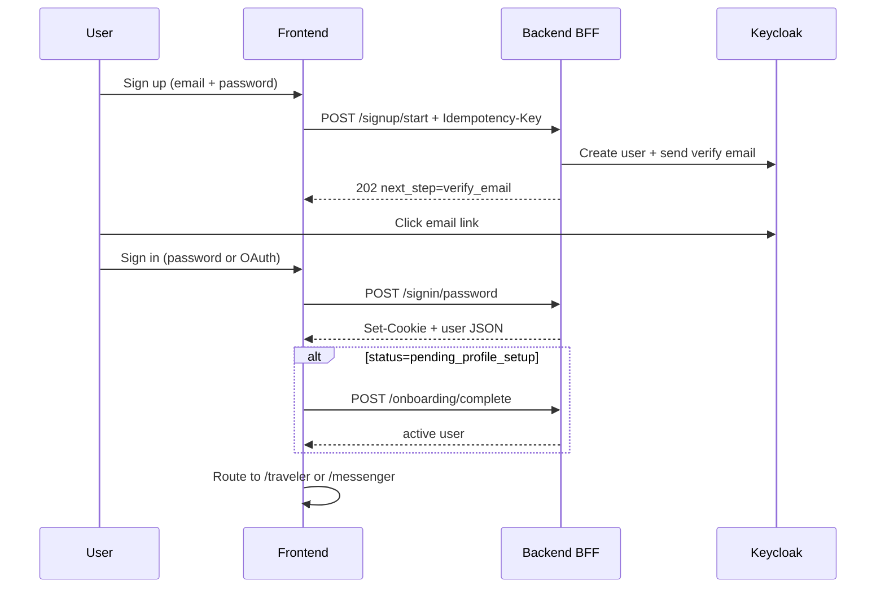

Here is a **complete end-to-end guide** for your auth APIs, based on `chatapp-backend` + `connect-carry`. Your repo already has pieces in [`docs/auth-architecture.md`](file:///home/karthik/Downloads/chatapp-backend/docs/auth-architecture.md), [`README.md`](file:///home/karthik/Downloads/chatapp-backend/README.md), and [`docs/keycloak-setup-guide.md`](file:///home/karthik/Downloads/chatapp-backend/docs/keycloak-setup-guide.md). Below is a single runbook you can use to **write, test, and document** every auth path.

---

## Mental model (write this first in any doc)

Three layers work together:

| Layer | Role |
|--------|------|
| **Keycloak** | Passwords, email verify, OAuth (Google), JWTs |
| **PostgreSQL** | App user status, BFF sessions, PKCE state |
| **FastAPI BFF** (`/v1/auth`) | Orchestrates flows, sets **HttpOnly cookies**, never exposes tokens to the browser |

**Critical rule:** Clicking the verify-email link updates Keycloak only. Postgres stays `pending_verification` until the user **signs in** (or the reconcile job runs).

---

## Part 1 — One-time setup (required before any auth API works)

### 1. Start infrastructure

```bash
cd chatapp-backend
cp .env.example .env
docker compose up -d
uv run python scripts/run_migrations.py
uv run uvicorn main:app --reload --host 0.0.0.0 --port 8000
```

### 2. Configure Keycloak (one time)

Follow [`docs/keycloak-setup-guide.md`](file:///home/karthik/Downloads/chatapp-backend/docs/keycloak-setup-guide.md):

- Realm: `chatapp`
- Clients: `chatapp-web` (OAuth), `chatapp-api` (JWT audience), `chatapp-backend-admin` (Admin API)
- SMTP for verification emails (optional script: `scripts/configure_keycloak_smtp.py`)
- On `chatapp-web`: enable **direct access grants** only if you use password sign-in

### 3. Start frontend

```bash
cd connect-carry
# VITE_BACKEND_URL=http://localhost:8000 (default)
npm run dev   # typically http://localhost:5173
```

### 4. Verify stack

```bash
curl http://localhost:8000/health/ready
curl http://localhost:8000/docs   # Swagger for all schemas
```

---

## Part 2 — Full auth API catalog

Base URL: `http://localhost:8000`

| Method | Endpoint | Auth | Purpose |
|--------|----------|------|---------|
| `POST` | `/v1/auth/signup/start` | Public | Email/password signup step 1 |
| `POST` | `/v1/auth/signup/complete` | Public | Signup step 2 (profile + role) |
| `POST` | `/v1/auth/signup/resend` | Public | Resend verification email |
| `POST` | `/v1/auth/signup/social/start` | Public | OAuth signup with role |
| `POST` | `/v1/auth/signin/start` | Public | Start OAuth/PKCE login |
| `GET` | `/v1/auth/signin/callback` | Public | OAuth callback (browser redirect) |
| `POST` | `/v1/auth/signin/password` | Public | Email/password login |
| `GET` | `/v1/auth/session` | Session cookie | Current user |
| `POST` | `/v1/auth/onboarding/complete` | Session cookie | Role + display name |
| `POST` | `/v1/auth/logout` | Session cookie | End session |
| `POST` | `/v1/auth/forgot-password` | Public | Password reset email |
| `GET` | `/v1/auth/sessions` | Session + `session:manage` | List sessions |
| `DELETE` | `/v1/auth/sessions/{id}` | Session + `session:manage` | Revoke one session |
| `DELETE` | `/v1/auth/sessions/all` | Session + `session:manage` | Revoke all sessions |
| `POST` | `/v1/auth/signup` | Public | **Deprecated** → `410 Gone` |

Frontend client: all of these are wrapped in `connect-carry/src/lib/bff.ts` under `auth.*`.

---

## Part 3 — End-to-end flows (step-by-step)

### Flow A — Email/password signup → verify → login → onboarding



**Step 1 — Signup start**

```bash
curl -X POST http://localhost:8000/v1/auth/signup/start \
  -H "Content-Type: application/json" \
  -H "Idempotency-Key: $(uuidgen)" \
  -d '{
    "email": "user@example.com",
    "password": "SecurePassw0rd!12",
    "device_fingerprint": "device-12345678"
  }'
```

Expected: `202` with `"next_step": "verify_email"`.

Requirements (from `SignupStartRequest`):
- Password min 12 chars + policy validation
- `device_fingerprint` min 8 chars
- **`Idempotency-Key` header required** (400 without it)

**Step 2 (optional) — Signup complete** (if you collect profile during signup)

```bash
curl -X POST http://localhost:8000/v1/auth/signup/complete \
  -H "Content-Type: application/json" \
  -d '{
    "signup_token": "<from signup/start if returned>",
    "display_name": "Jane Doe",
    "account_mode": "traveler"
  }'
```

**Step 3 — User verifies email** (browser only)

- User clicks Keycloak link in inbox
- Lands on frontend `/verify-email/complete` (must be in `chatapp-web` Valid Redirect URIs)

**Step 4 — Sign in with password**

```bash
curl -X POST http://localhost:8000/v1/auth/signin/password \
  -H "Content-Type: application/json" \
  -c cookies.txt \
  -d '{
    "email": "user@example.com",
    "password": "SecurePassw0rd!12"
  }'
```

Expected: `200` + `Set-Cookie: pp_session`, `pp_csrf` + user object.

If email not verified: error `email_verification_required` → frontend routes to `/verify-email/sent`.

**Step 5 — Onboarding** (if `status === "pending_profile_setup"`)

```bash
curl -X POST http://localhost:8000/v1/auth/onboarding/complete \
  -H "Content-Type: application/json" \
  -b cookies.txt \
  -H "X-CSRF-Token: <pp_csrf cookie value>" \
  -d '{
    "display_name": "Jane Doe",
    "account_mode": "traveler"
  }'
```

**Step 6 — Post-auth routing** (frontend logic in `post-auth-routing.ts`):

| User status | Route |
|-------------|-------|
| `pending_verification` | `/verify-email/sent` |
| `pending_profile_setup` / missing role | `/onboarding` |
| `active` + `account_mode` | `/traveler` or `/messenger` |

---

### Flow B — OAuth / Google sign-in

Google sign-in should **complete without** Keycloak’s “Account already exists” prompt when the email matches an existing user. The API configures Keycloak with the `chatapp-google-auto-link` first-broker-login flow (auto-link by email + create user when unique). Restart the API or run `uv run python scripts/configure_keycloak_google.py` after pulling this change.

**Step 1 — Start OAuth**

```bash
curl -X POST http://localhost:8000/v1/auth/signin/start \
  -H "Content-Type: application/json" \
  -d '{
    "identity_provider": "google",
    "post_signin_redirect_uri": "http://localhost:8080/auth/callback"
  }'
```

Expected: `{ "authorization_url", "state", "expires_at" }`.

**Step 2 — Browser redirect**

- Open `authorization_url` in browser
- Complete Google/Keycloak login
- Keycloak redirects to **`GET /v1/auth/signin/callback`** (backend URL, not frontend)
- Backend sets cookies and redirects to `post_signin_redirect_uri` with user in URL hash `#u=<base64 json>`

**Step 3 — Frontend callback**

- `AuthCallbackPage` parses hash, calls `auth.session()` or uses hash user
- `resolvePostAuthPath()` decides next page

---

### Flow C — Social signup (Google with role upfront)

```bash
curl -X POST http://localhost:8000/v1/auth/signup/social/start \
  -H "Content-Type: application/json" \
  -d '{
    "identity_provider": "google",
    "account_mode": "messenger",
    "device_fingerprint": "device-12345678",
    "post_signin_redirect_uri": "http://localhost:8080/auth/callback"
  }'
```

Then same OAuth browser flow as Flow B. If no local user exists, one is created and linked to Keycloak `sub`.

---

### Flow D — Session lifecycle

**Check session (page refresh / app boot)**

```bash
curl http://localhost:8000/v1/auth/session -b cookies.txt
```

**Logout**

```bash
curl -X POST http://localhost:8000/v1/auth/logout \
  -b cookies.txt \
  -H "X-CSRF-Token: <csrf>"
```

```bash
curl -X POST http://localhost:8000/v1/auth/logout \
  -H "Cookie: pp_session=OoDRrMbgtyDkzBkEvCF1Q3mk643NY1xjHQv342yaeMs; pp_csrf=xT9Nl68o4r75kK6J_hosocjhZBDCevJcokaOZIxgsrI" \
  -H "X-CSRF-Token: xT9Nl68o4r75kK6J_hosocjhZBDCevJcokaOZIxgsrI"
```

Returns Keycloak logout URL; cookies cleared.

**List / revoke sessions** (needs `session:manage` capability)

```bash
curl http://localhost:8000/v1/auth/sessions -b cookies.txt

curl -X DELETE http://localhost:8000/v1/auth/sessions/<id> \
  -b cookies.txt -H "X-CSRF-Token: <csrf>"

curl -X DELETE http://localhost:8000/v1/auth/sessions/all \
  -b cookies.txt \
  -H "Content-Type: application/json" \
  -H "X-CSRF-Token: <csrf>" \
  -d '{"keep_current": true}'
```

---

### Flow E — Forgot password & resend verification

**Forgot password** (always generic response — no email enumeration)

```bash
curl -X POST http://localhost:8000/v1/auth/forgot-password \
  -H "Content-Type: application/json" \
  -d '{"email": "user@example.com"}'
```

**Resend verification**

```bash
curl -X POST http://localhost:8000/v1/auth/signup/resend \
  -H "Content-Type: application/json" \
  -d '{"email": "user@example.com"}'
```

Expected: `202` with `"next_step": "check_email"`.

---

## Part 4 — How to **write** proper E2E instructions (template)

For each endpoint, document these sections (your README/API doc should follow this):

1. **Purpose** — one sentence
2. **Auth required** — public / session cookie / capability
3. **Headers** — `Idempotency-Key`, `X-CSRF-Token`, `Content-Type`
4. **Request body** — JSON schema (link to `v1/schemas/auth_bff.py` or Swagger)
5. **Success response** — status code + example JSON
6. **Error responses** — codes like `email_verification_required`, `invalid_credentials`, rate limits
7. **Side effects** — Postgres status change, Keycloak action, cookies set
8. **Frontend caller** — e.g. `auth.signupStart()` in `bff.ts`
9. **Next step in UX** — which page/route comes after
10. **Prerequisites** — Keycloak client settings, redirect URIs

Example snippet for one endpoint:

> **`POST /v1/auth/signup/start`**
> - **Auth:** none  
> - **Headers:** `Idempotency-Key: <uuid>` (required)  
> - **Body:** `{ email, password, device_fingerprint, captcha_token? }`  
> - **Success:** `202` → `{ status: "accepted", next_step: "verify_email" }`  
> - **Creates:** Postgres user `pending_verification`, Keycloak user, verification email  
> - **Frontend:** `SignupPage` → `/verify-email/sent`  
> - **Note:** duplicate/disposable emails still get generic success (anti-enumeration)

---

## Part 5 — Security / integration details (don’t skip in docs)

Document these cross-cutting rules:

| Topic | Behavior |
|--------|----------|
| **Cookies** | `pp_session` (HttpOnly), `pp_csrf` |
| **CSRF** | Mutating requests need `X-CSRF-Token` matching cookie; auth signup/signin paths are excluded (see `CSRF_EXCLUDED` in `bff.ts`) |
| **CORS + credentials** | Frontend must call BFF with `credentials: "include"` |
| **OAuth callback** | Backend URL (`AUTH_CALLBACK_URL`), not frontend |
| **Email verify redirect** | Must match `chatapp-web` Valid Redirect URIs exactly |
| **Protected routes** | Accept Bearer JWT **or** session cookie |

---

## Part 6 — Automated E2E testing checklist

| Test | What to assert |
|------|----------------|
| Signup without idempotency key | `400` |
| Signup with valid payload | `202`, `next_step=verify_email` |
| Deprecated `/signup` | `410` |
| Signin unverified user | `email_verification_required` |
| Signin verified user | cookies set, user returned |
| OAuth start | URL contains PKCE params / `state` |
| Session after login | `GET /session` returns user |
| Onboarding | status becomes `active` |
| Logout | cookies cleared |
| Forgot/resend | generic success regardless of email existence |

Existing tests: `tests/test_auth_api.py`, `tests/test_auth_signup_integration.py`.

---

## Part 7 — Common failures (troubleshooting section for your doc)

| Symptom | Likely cause |
|---------|----------------|
| Signup fails at Keycloak | Realm/clients not configured; see keycloak setup guide |
| Verify link broken | Redirect URI mismatch on `chatapp-web` |
| Password sign-in 400/401 | Direct access grants disabled on `chatapp-web` |
| Session always 401 | Cookies not sent (missing `credentials: include` or wrong domain) |
| User stuck on verify page | Verified in Keycloak but never signed in — must call signin API |
| Backend won't start | Keycloak startup validation failed — check `.env` + clients |

See also [`docs/troubleshooting-keycloak.md`](file:///home/karthik/Downloads/chatapp-backend/docs/troubleshooting-keycloak.md).

---

## Suggested doc structure (if you’re writing one file)

```markdown
# Auth API — End-to-End Guide

1. Architecture overview (BFF + Keycloak + Postgres)
2. Prerequisites & local setup
3. User lifecycle states
4. Flow guides (A–E above)
5. API reference (table + per-endpoint detail)
6. Frontend integration (bff.ts, routing)
7. curl examples
8. Error codes
9. Keycloak configuration checklist
10. Testing & troubleshooting
```

---

## Summary

To document or exercise **all auth APIs end-to-end**:

1. **Set up** Docker + Keycloak + migrations + frontend  
2. **Follow user journeys** (signup → verify → signin → onboarding → session → logout), not isolated endpoints  
3. **Use the endpoint table** above as your API index  
4. **Match frontend** calls in `src/lib/bff.ts` and routing in `post-auth-routing.ts`  
5. **Use Swagger** at `/docs` for exact request/response schemas from `v1/schemas/auth_bff.py`

If you want this turned into a single markdown file in the repo (e.g. `docs/auth-api-e2e-guide.md`), switch to **Agent mode** and I can draft it there. Or say which flow you care about most (signup-only, OAuth-only, session management) and I can expand just that path with every error code from the service layer.
